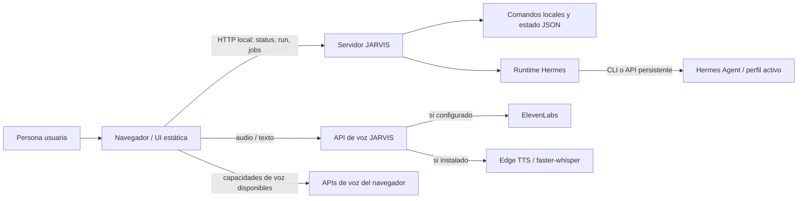
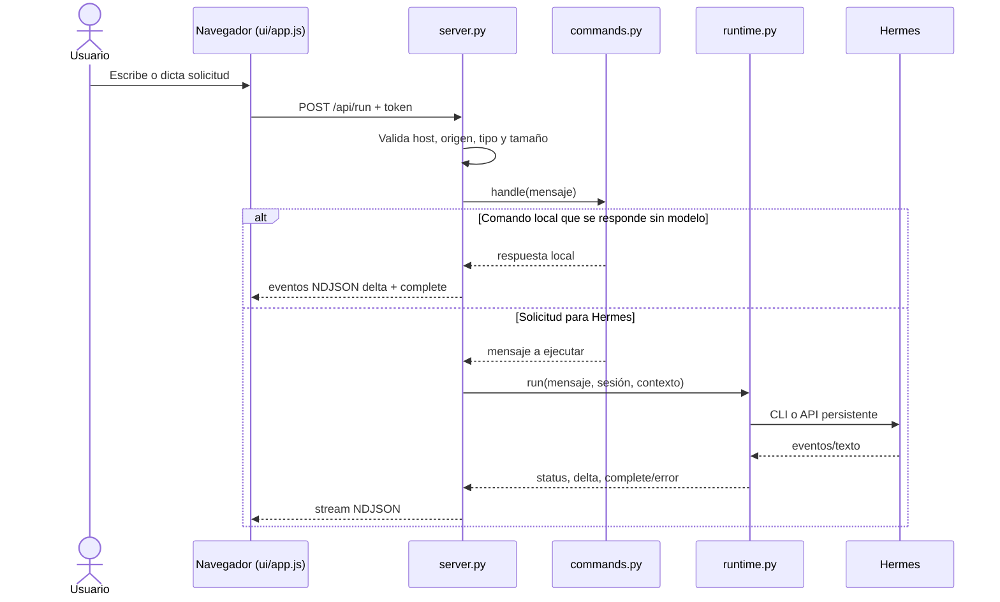
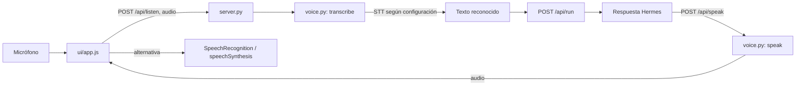

# Diagramas

## Contexto del sistema

**Evidencia:** `server.py` (rutas HTTP, `main()`), `runtime.py` (`run()`), `commands.py` (comandos/estado), `voice.py` (proveedores), `ui/app.js` (interacción browser). La opción de API persistente está en `runtime.py` (`_api_conf()`, `run_api()`).

## Ejecución de una solicitud

## Voz (simplificado)

La selección real depende de proveedor configurado, módulos instalados y capacidades del navegador. [Verificado: `voice.py`, `server.py`, `ui/app.js`]
